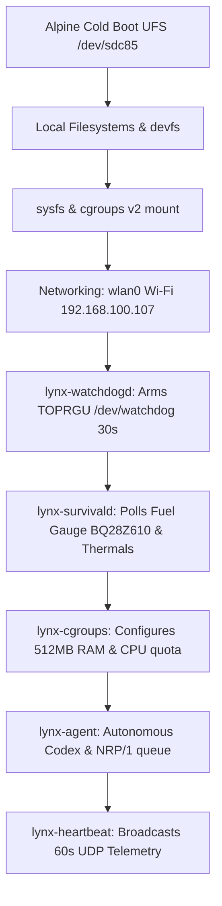
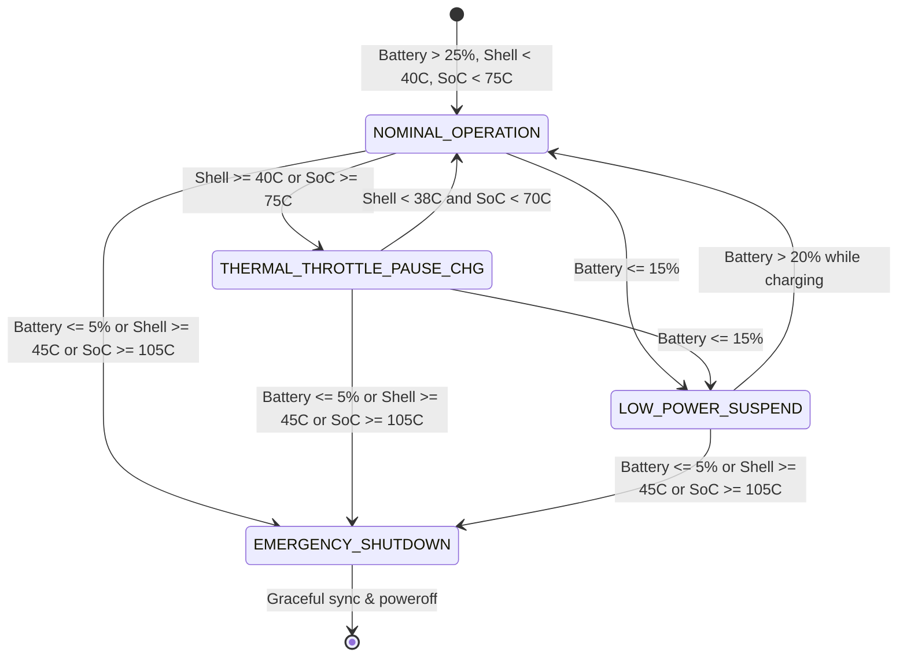

# Lynx Autonomous Linux Service Architecture & Untethered Operational Manual

**Platform:** OnePlus Nord 3 5G (`CPH2493` / SoC MediaTek MT6983 Dimensity 9000 / Board `22823`)
**Operating System:** Alpine Linux (native ARM64 mainline port, kernel 6.x)
**Author:** Banshee (Spirit of Initiative 💙)
**Date:** 2026-11-21
**Deliverable:** Task B32 (Round 8 Queue)

---

## 1. Executive Summary

This specification establishes the software supervision architecture required to transition the Lynx phone from an interactive, tethered developer environment into a resilient, autonomous, self-preserving edge agent.

Without human operators watching active SSH sessions, the operating system must autonomously ensure that:
1. System lockups, hangs, and deadlocks trigger an automatic hardware watchdog reboot via MediaTek TOPRGU.
2. Battery depletion and thermal spikes trigger automated throttling, low-power suspend (SCP/LPM), or graceful emergency shutdown before brownouts or hardware degradation occur.
3. Agent processes are sandboxed via cgroups v2 to prevent Out-Of-Memory (OOM) termination of core networking and maintenance routes.
4. Periodic telemetry heartbeats are transmitted to the Noobian Council (Nexus) over NRP/1 UDP.

---

## 2. Boot & Service Lifecycle Graph

The autonomous service layer is orchestrated through Alpine Linux's OpenRC init system:

### 2.1 Service Dependency Tree

| OpenRC Service | Runlevel | Dependencies (`need`/`after`) | Description |
|---|---|---|---|
| `sysfs` | `sysinit` | — | Mounts `/sys` and `/sys/fs/cgroup` |
| `networking` | `boot` | `sysfs` | Brings up `wlan0`, joins internal Noobia Wi-Fi |
| `lynx-watchdogd` | `default` | `need localmount`, `before networking` | Initializes `/dev/watchdog` (30s) and pets every 5s |
| `lynx-survivald` | `default` | `after lynx-watchdogd` | Evaluates B28 decision matrix every 10s |
| `lynx-cgroups` | `default` | `after sysfs` | Enforces 512MB limit on `lynx-agent` cgroup |
| `lynx-agent` | `default` | `after lynx-survivald lynx-cgroups` | Executes autonomous agent workflows |
| `lynx-heartbeat` | `default` | `after lynx-agent networking` | Emits 60s status packets to Nexus |

---

## 3. Hardware Watchdog Petting Contract (TOPRGU MT6983)

1. **Hardware Timer:** `watchdog@1c007000` (MediaTek MT6983 / MT6589 WDT)
2. **Timeout Window:** Configured to **30 seconds** (hardware maximum is 32 seconds).
3. **Software Petting Interval:** The `lynx-watchdogd` supervisor pets the device every **5 seconds**.
4. **Pre-Pet Health Assertions:**
   - Available system memory $> 50\text{ MiB}$
   - Root filesystem is read-write (no remount-ro due to UFS I/O errors)
   - 1-minute CPU load average $< 16.0$
5. **Failure & Recovery:**
   - If `lynx-watchdogd` crashes or health checks fail, petting ceases.
   - After 30 seconds of silence, TOPRGU asserts SoC reset.
   - `reboot-mode` syscon register (`offset 0x24`) executes a clean reboot into the known-good V53 Alpine kernel image.

---

## 4. Multi-Sensor Survival State Machine

The `lynx-survivald` daemon evaluates physical telemetry against the four deterministic policy states established in B28:

---

## 5. Cgroups v2 Sandboxing Parameters

Autonomous agent code is migrated into `/sys/fs/cgroup/lynx-agent/`:
- `memory.max`: `536870912` (512 MiB maximum resident RAM).
- `memory.high`: `419430400` (400 MiB throttle threshold; triggers background reclaim).
- `cpu.max`: `150000 100000` (Caps background agent loops to 1.5 cores equivalent).
- `memory.oom.group`: `1` (If memory is exceeded, the agent process group is killed cleanly rather than affecting system daemons).

---

## 6. Remote Telemetry & Heartbeat Contract

- **Protocol:** NRP/1 over UDP
- **Destination:** Nexus `192.168.100.106:4244`
- **Cadence:** 60 seconds nominal; 15 seconds during `THERMAL_THROTTLE_PAUSE_CHG`
- **Packet Contents:** Battery SoC %, series cell delta, shell temperature, SoC temperature, survival state, watchdog state, and cgroup memory usage.
