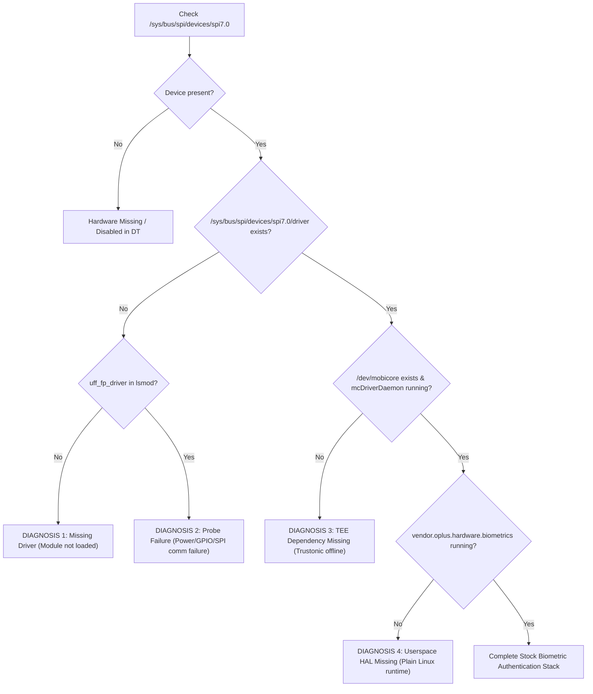

# Lynx Fingerprint Identity and Secure Boundary Analysis (2026-11-21)

## Executive Summary

This document establishes the hardware identity, source lineage, and security boundary analysis for the under-display optical fingerprint subsystem on the OnePlus Nord 3 5G (Lynx, CPH2493, MediaTek MT6983 / Dimensity 9000) running native Alpine Linux on boot `0fe847d2-44d6-4ac1-9000-2c99df1a51d8`.

It builds on [`LYNX-FINGERPRINT-PREFLIGHT-20261121.md`](file:///noobia/lynx/linux-port/docs/LYNX-FINGERPRINT-PREFLIGHT-20261121.md) and delivers the read-only acceptance tooling in [`lynx/tools/fingerprint/lynx_fingerprint_inventory.py`](file:///noobia/lynx/tools/fingerprint/lynx_fingerprint_inventory.py).

**Current Live Status:** `hardware_present_driver_missing`
*   **Hardware Layer:** Present and active in device tree (`spi7@11017000/fingerprint@0`, compatible `oplus,fp_spi`) and enumerated as `/sys/bus/spi/devices/spi7.0`.
*   **Linux Driver Layer:** Unbound. Stock vendor module `uff_fp_driver.ko` is not loaded into kernel memory.
*   **TEE Layer:** Offline. Trustonic Kinibi TEE driver `mcDrvModule.ko` is not resident, and no `/dev/mobicore` interface exists.
*   **Userspace Layer:** Plain Alpine userspace. No Android biometrics HAL or High Brightness Mode (HBM) display coordinator is installed or running.

---

## 1. Hardware Bus & Exact Source Lineage

### 1.1 Device Tree Node (`fingerprint@0`)
*   **DT Path:** `/sys/firmware/devicetree/base/spi7@11017000/fingerprint@0`
*   **Compatible String:** `oplus,fp_spi`
*   **Host Controller:** MediaTek MT6983 SPI controller 7 (`11017000.spi`), managed by kernel driver `spi_mt65xx`.
*   **Linux Bus Device:** `/sys/bus/spi/devices/spi7.0` (SPI bus 7, chip select 0).
*   **Modalias:** `spi:fp_spi`
*   **DT Hardware Properties:**
    *   `reg = <0x0>` (Chip Select 0).
    *   `uff,gpio_cs`, `uff,gpio_irq`, `uff,gpio_reset`: Dedicated GPIO pin assignments for hardware chip-select, interrupt request, and sensor reset lines.
    *   `dvdd-supply = <0x48>`: Phandle pointing to PMIC LDO supplying digital power to the optical sensor.
    *   `spi-max-frequency = <0x17d7840>` (25 MHz SPI clock).

### 1.2 Stock Kernel Module Architecture
Stock August OxygenOS (`CPH2493EEA`) structures fingerprint support across two vendor kernel modules in `wifi-reference/vendor-dlkm-unpacked/lib/modules/`:

1.  **`uff_fp_driver.ko`** (Unified Fingerprint Framework):
    *   SHA-256: `209e98c7b2ddafb345e5504f732815488992ff84964b5429b48757bf08093820`
    *   Kernel Vermagic: `5.10.149-android12-9-o-g311738fbb5a8 SMP preempt mod_unload modversions aarch64` (exact byte-for-byte match with Lynx running kernel).
    *   Matches OF compatible table: `oplus,fp_spi`.
    *   Creates character device `/dev/fingerprint_dev` (`fp_class`) and input device `oplus_fp_input`.
    *   Registered dependencies: `olc`, `oplus_bsp_tp_notify`, `mtk_disp_notify`, `spi-mt65xx`.
    *   *Residency on Lynx V53:* `spi-mt65xx`, `olc`, `oplus_bsp_tp_notify`, and `mtk_disp_notify` are **already resident** in kernel memory! Only `uff_fp_driver.ko` itself is unloaded.

2.  **`oplus_fp_common.ko`** (TEE & Core Affinity Support):
    *   SHA-256: `c73277cf1328ae60737346cc4281def91c4ea2806ad33136be5a30708d8f8469`
    *   Binds TEE worker threads to big cores and logs detected sensor vendor (`goodix`, `focaltech`, `silead`).

---

## 2. Diagnostic Distinction: Missing Driver vs. TEE vs. Userspace

A critical objective of this analysis is providing the precise observable facts that differentiate:
- A missing Linux kernel driver,
- A Trust Execution Environment (TEE) dependency,
- An unfulfilled userspace Android HAL dependency.

### Detailed Diagnostic Matrix:

| Observable Fact / Query | Diagnosis 1: Missing Driver | Diagnosis 2: Hardware Probe Failure | Diagnosis 3: TEE Missing | Diagnosis 4: Userspace HAL Missing |
| :--- | :--- | :--- | :--- | :--- |
| **`/sys/bus/spi/devices/spi7.0`** | Present | Present | Present | Present |
| **`spi7.0/driver` symlink** | **Absent** | **Absent** | **Present** (`fp_spi_driver`) | **Present** (`fp_spi_driver`) |
| **`lsmod \| grep uff_fp_driver`** | **Absent** | **Present** | **Present** | **Present** |
| **Kernel dmesg logs** | No log lines | `probe failed with error ...` | `fp_spi_driver probed successfully` | `fp_spi_driver probed successfully` |
| **`/dev/fingerprint_dev`** | **Absent** | **Absent** | **Present** | **Present** |
| **`/dev/mobicore` & `mcDrvModule`** | Irrelevant | Irrelevant | **Absent** | **Present** |
| **`ps \| grep mcDriverDaemon`** | Irrelevant | Irrelevant | **Absent** | **Present** |
| **`ps \| grep fingerprint`** | Irrelevant | Irrelevant | Irrelevant | **Absent** (Plain Alpine userspace) |
| **Optical HBM illumination** | Inactive | Inactive | Inactive | **Absent** (Requires display coordination) |

### Key Diagnostic Rules:
1. **Rule of Driver Isolation:** If `/sys/bus/spi/devices/spi7.0/driver` is absent and `uff_fp_driver` is not in `lsmod`, the bottleneck is **strictly the missing kernel module**. Neither TEE nor userspace has been invoked yet.
2. **Rule of TEE Separation:** The Linux kernel driver `uff_fp_driver` manages power, hardware reset GPIO, and SPI bus transfers. It can successfully probe, bind to `spi7.0`, and register `/dev/fingerprint_dev` **without** TEE or Android HAL running! TEE is required only when userspace attempts to open a secure channel for cryptographic enrollment and biometric template matching.
3. **Rule of Optical Sensing:** Because Lynx uses an under-display optical sensor, biometric capture cannot physically occur in darkness. The sensor requires display High Brightness Mode (`/sys/kernel/oplus_display/hbm`) to illuminate the finger.

---

## 3. Inventory Tooling & Live Foothold Verification

The task-owned tool [`lynx_fingerprint_inventory.py`](file:///noobia/lynx/tools/fingerprint/lynx_fingerprint_inventory.py) performs bounded read-only inspection.

### 3.1 Live Telemetry Capture (Boot `0fe847d2-44d6-4ac1-9000-2c99df1a51d8`)
*   **Subsystem Verdict:** `HARDWARE_PRESENT_DRIVER_MISSING`
*   **Hardware Layer:** Present (DT node: `oplus,fp_spi`, Bus device: `spi7.0`, Controller driver: `spi_mt65xx`).
*   **Kernel Driver Layer:** `missing_driver` (`driver_bound=False`, `uff_fp_driver_loaded=False`).
*   **TEE Boundary Layer:** `tee_driver_missing` (`mcDrvModule_loaded=False`, `/dev/mobicore=False`).
*   **Userspace Layer:** `hal_absent` (`character_device=False`, `hal_service_running=False`).
*   **Identified Gaps:**
    1. Kernel driver `uff_fp_driver.ko` is not loaded into memory.
    2. Trustonic TEE kernel driver `mcDrvModule.ko` is not loaded.
    3. Stock biometrics HAL daemon and `/dev/fingerprint_dev` are absent.

---

## 4. Operating Boundaries for Future Active Trials

In strict accordance with Noobia safety policies:
*   **No Active Operations in this Item:** No SPI bus transfers, no biometric capture, no module insertion, and no secure-world calls were performed.
*   **Separately Reviewed Trial Plan:** Any future live driver trial must remain a separately reviewed proposal requiring:
    1. Attended session with Noob physically present.
    2. 120-second hardware watchdog armed prior to module load.
    3. RAM-only temporary staging under `/run/lynx-fp-ram-<timestamp>/`.
    4. Immediate post-probe unloading to restore the clean V53 baseline.
