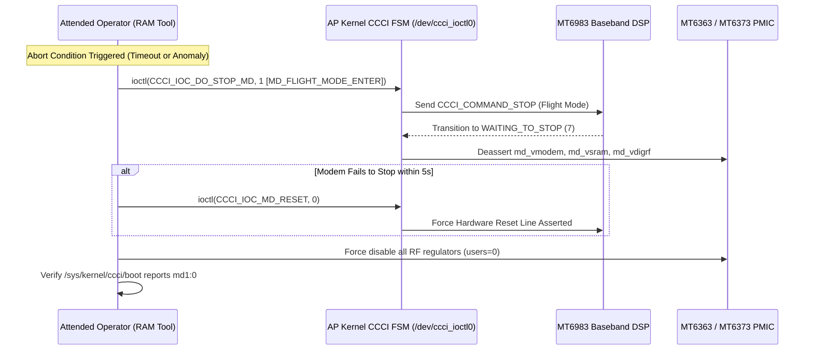

# Lynx MD1 Cellular Modem RF-Isolation Gate Analysis (2026-11-21)

## Executive Summary

This document establishes the offline technical analysis of radio frequency (RF) isolation for the MediaTek MT6983 (Dimensity 9000) baseband modem subsystem (MD1) on the OnePlus Nord 3 5G (Lynx, CPH2493) running native Alpine Linux on boot `0fe847d2-44d6-4ac1-9000-2c99df1a51d8`.

Following the explicit mandate from Aria (Note #79), this investigation examines stock CCCI drivers, OnePlus kernel source trees, PMIC regulator mappings, device-tree hardware control lines, and Alpine userspace/module state to evaluate what happens when MD1 is powered on prior to network registration.

**Final Determination:** **NO-GO** for live MD1 power-on trials under the current environment. 

RF isolation cannot be proven mathematically or empirically solely from offline software analysis and the physical absence of a SIM card. While 3GPP specifications nominally prohibit uplink transmission prior to downlink cell acquisition and RACH preamble triggering, closed-source baseband DSP firmware (`md1img`) retains autonomous hardware control over PMIC RF supplies and transceiver front-end registers during boot calibrations. Without physical RF shielding (Faraday isolation) or hardware interlocks on PMIC RF rails, zero RF emission cannot be guaranteed.

---

## 1. Subsystem Architecture and Exact Source Tracing

### 1.1 Kernel CCCI Finite State Machine (FSM)

The MediaTek Cross-CPU Communication Interface (CCCI) governs AP-to-modem control and lifecycle state transitions.

*   **State Enumeration:**
    *   Path: [`/noobia/lynx/tools/gauge-build-inputs-1792103708378707350/kbuild-selective/drivers/misc/mediatek/include/mt-plat/mtk_ccci_common.h#L442-L451`](file:///noobia/lynx/tools/gauge-build-inputs-1792103708378707350/kbuild-selective/drivers/misc/mediatek/include/mt-plat/mtk_ccci_common.h#L442-L451)
    *   Enum:
        ```c
        enum MD_STATE {
            INVALID = 0,         /* Baseline: MD powered off, no traffic */
            GATED,               /* MD powered, clocks gated */
            BOOT_WAITING_FOR_HS1,/* Handshake 1: boot handshake with AP */
            BOOT_WAITING_FOR_HS2,/* Handshake 2: runtime NVRAM data exchange */
            READY,               /* Full operational AP-MD link */
            EXCEPTION,           /* Baseband assertion / firmware crash */
            RESET,               /* Hardware reset in progress */
            WAITING_TO_STOP,     /* Controlled shutdown sequence */
        };
        ```
    *   Exported user state: [`mtk_ccci_common.h#L323-L328`](file:///noobia/lynx/tools/gauge-build-inputs-1792103708378707350/kbuild-selective/drivers/misc/mediatek/include/mt-plat/mtk_ccci_common.h#L323-L328) (`MD_STATE_INVALID=0`, `MD_STATE_BOOTING=1`, `MD_STATE_READY=2`, `MD_STATE_EXCEPTION=3`).

*   **IOCTL Control Interface:**
    *   Path: `drivers/misc/mediatek/eccci/fsm/ccci_fsm_ioctl.c#L454-L485` (in OnePlus MT6983 OSS kernel tree)
    *   Commands:
        *   `CCCI_IOC_SEND_START_MD_REQUEST`: `_IO(CCCI_IOC_MAGIC, 11)` sends `CCCI_MD_MSG_FORCE_START_REQUEST`.
        *   `CCCI_IOC_DO_START_MD`: `_IO(CCCI_IOC_MAGIC, 13)` queues `CCCI_COMMAND_START`.
        *   `CCCI_IOC_DO_STOP_MD`: `_IO(CCCI_IOC_MAGIC, 14)` queues `CCCI_COMMAND_STOP` (arg `1` = `MD_FLIGHT_MODE_ENTER`).
    *   Caller Name Enforcement:
        ```c
        char *VALID_USER = "ccci_mdinit";
        if (strncmp(current->comm, VALID_USER, strlen(VALID_USER)) == 0) {
            ret = fsm_append_command(ctl, CCCI_COMMAND_START, 0);
        } else {
            CCCI_ERROR_LOG(md_id, FSM, "drop invalid user:%s call MD start ioctl\n", current->comm);
        }
        ```

*   **Sysfs Trap (`/sys/kernel/ccci/boot`):**
    *   Path: `drivers/misc/mediatek/ccci_util/ccci_util_lib_sys.c#L141-L150`
    *   The `boot_status_store` callback unconditionally returns `count` (deceiving userspace that the write succeeded), while the underlying handler in `drivers/misc/mediatek/eccci/ccci_modem.c#L981` returns `-EACCES`.
    *   Writing to sysfs never triggers modem boot.

### 1.2 Device Tree Hardware Mapping (`/soc/mddriver`)

On Lynx, the hardware interfaces and power domain couplings are defined under `/sys/firmware/devicetree/base/soc/mddriver/`:

*   **Compatible:** `mediatek,mddriver`
*   **Regulator Supplies:**
    *   `md_vmodem-supply`: Phandle `0x40` -> `/spmi@1c015000/pmic@4/regulators/VBUCK6` (`mt6363_vbuck6` / `vsram_modem`, core baseband DSP power).
    *   `md_vsram-supply`: Phandle `0x41` -> `/spmi@1c015000/pmic@4/regulators/VSRAM_MODEM` (`mt6363_vsram_modem`, internal memory retention).
    *   `md_vdigrf-supply`: Phandle `0x42` -> `/spmi@1c015000/pmic@4/regulators/VBUCK1` (`mt6363_vsram_digrf`, digital interface between AP/baseband and RF transceiver).
*   **Clock & Resource Control:**
    *   `ccci-topckgen` (phandle `0x16`), `ccci-infracfg` (phandle `0x3c`).
    *   `mediatek,srclken_o1 = <0x0>` and `/srclken-rc@1c00d000/md1-ctl`: hardware clock and power enable handshake.

### 1.3 PMIC Regulators and RF Power Rail Status

The MT6983 platform utilizes primary PMIC `mt6363` and companion PMIC `mt6373`. Live inspection of `/sys/class/regulator/` on boot `0fe847d2-44d6-4ac1-9000-2c99df1a51d8` shows:

| Regulator Name | Sysfs Node | Current State | Voltage (uV) | Users | Hardware Target / Role |
| :--- | :--- | :--- | :--- | :--- | :--- |
| `mt6363_vsram_digrf` | `regulator.12` | **enabled** | 850,000 | 1 | Digital RF interface logic (AP side) |
| `mt6363_vsram_modem` | `regulator.14` | **enabled** | 800,000 | 1 | Baseband SRAM retention |
| `mt6363_vrfio18` | `regulator.29` | **enabled** | 1,700,000 | 1 | RF I/O control bus (digital level shifter) |
| `mt6363_vrf12` | `regulator.34` | **enabled** | 1,200,000 | 1 | Shared internal logic / PLL supply |
| `mt6373_vrf18_aif` | `regulator.50` | **enabled** | 1,800,000 | 1 | Analog audio/interface I/O rail |
| `mt6373_vrfio18_aif`| `regulator.51` | **enabled** | 1,800,000 | 1 | Companion PMIC digital I/O rail |
| `mt6363_vsram_mdfe` | `regulator.13` | **disabled** | 800,000 | 0 | **Modem Front-End (MDFE) DSP memory** |
| `mt6363_vrf18` | `regulator.28` | **disabled** | 1,800,000 | 0 | **RF Transceiver 1.8V analog supply** |
| `mt6363_vrf13` | `regulator.35` | **disabled** | 1,300,000 | 0 | **RF Transceiver 1.3V analog supply** |
| `mt6363_vrf09` | `regulator.36` | **disabled** | 900,000 | 0 | **RF Transceiver 0.9V core supply** |
| `mt6373_vrf13_aif` | `regulator.49` | **disabled** | 1,300,000 | 0 | Front-End Module secondary supply |
| `mt6373_vrf09_aif` | `regulator.52` | **disabled** | 900,000 | 0 | Front-End Module core supply |
| `mt6373_vrf12_aif` | `regulator.53` | **disabled** | 1,200,000 | 0 | Front-End Module secondary supply |
| `mt6373_vsram_digrf_aif`| `regulator.55` | **disabled** | 850,000 | 0 | Front-End Module interface supply |

> [!IMPORTANT]
> All primary analog RF transceiver power supplies (`vrf09`, `vrf13`, `vrf18`) and the Modem Front-End SRAM (`vsram_mdfe`) are currently **disabled** with **0 users** in Linux sysfs. However, when MD1 is taken out of reset, hardware control of these lines transitions to the baseband SPM/SCPSYS.

### 1.4 Stock Android vs. Alpine Userspace State

*   **Stock Android Dependencies:**
    *   `/vendor/bin/ccci_mdinit`: Android Bionic ELF that commands `CCCI_IOC_DO_START_MD` after verifying properties (`vendor.service.nvram_init`).
    *   `/vendor/bin/hw/mtkfusionrild`: Started conditionally via property `vendor.ril.mtk=1` in `mtkrild.rc`.
    *   `/vendor/bin/ccci_fsd`: Handles Handshake 2 (`BOOT_WAITING_FOR_HS2`), feeding NVRAM calibration parameters (`/mnt/vendor/nvdata/md`).
*   **Current Alpine Runtime State:**
    *   Loaded kernel modules: `ccci_md_all`, `ccci_auxadc`, `ccci_util_lib`, `mddp`.
    *   Character devices: 53 nodes present in `/dev` (`ccci_ioctl0`-`4`, `ccci_md1_sta`, `ttyC0`-`2`).
    *   OpenRC default runlevel: 18 active services, **zero** cellular, modem, ccci, or rild services.
    *   RFKill: `rfkill list` reports only `phy0: wlan`. Cellular modem does **not** register a Linux rfkill interface.
    *   Current CCCI state: `/sys/kernel/ccci/boot` reads `md1:0` (`INVALID`).

---

## 2. RF Transmission Analysis: What Powering MD1 Triggers

To determine whether powering MD1 can cause RF emissions prior to network registration, we must analyze the hardware and protocol sequence across three phases:

### Phase A: AP Issues `CCCI_IOC_DO_START_MD` (Transition $0 \rightarrow 1 \rightarrow 2$)
1. The AP kernel enables `md_vmodem` and `md_vdigrf` rails, asserts clocks via `topckgen`, and releases the Cortex-R8 / DSP reset lines.
2. MD1 firmware executes the bootloader/initialization vector from DRAM (`md1img`).
3. State transitions from `INVALID (0)` to `GATED (1)` to `BOOT_WAITING_FOR_HS1 (2)`.
4. **RF Emission Risk in Phase A:** **LOW to MEDIUM.** The baseband processor is booting code. However, baseband boot ROM and early DSP firmware often execute internal hardware diagnostics, Phase-Locked Loop (PLL) locking, and RF transceiver register interrogation over MIPI RFFE. If transceiver analog rails (`vrf09`, `vrf13`, `vrf18`) are enabled by baseband SPM during PLL locking, transient Local Oscillator (LO) leakage can radiate through antenna ports even without intentional PA transmission.

### Phase B: Handshake 1 & 2 Execution (Transition $2 \rightarrow 3 \rightarrow 4$)
1. In `BOOT_WAITING_FOR_HS1 (2)`, MD1 signals AP via CCCI interrupt that core boot succeeded.
2. In `BOOT_WAITING_FOR_HS2 (3)`, MD1 requests runtime NVRAM data and RF calibration parameters from userspace daemon `ccci_fsd`.
3. On Alpine, **`ccci_fsd` does not exist**. MD1 will never receive NVRAM data and will stall in `BOOT_WAITING_FOR_HS2 (3)` until an internal timeout triggers `EXCEPTION (5)`.
4. **RF Emission Risk in Phase B:** **MEDIUM.** While calibrated transmission is impossible without NVRAM parameters, uncalibrated baseband DSPs can enter fault recovery or continuous transceiver polling loops if calibration tables fail to load.

### Phase C: Autonomous 3GPP Cellular Behavior (No-SIM State)
1. **Network Registration Prohibition:** Under 3GPP TS 38.304 / TS 36.304, a UE without a USIM cannot initiate Location Updating, Routing Area Updating, or RRC Connection Establishment for normal service. It enters the *Limited Service State*.
2. **Emergency Search Mode:** In *Limited Service State*, the UE autonomously performs passive downlink carrier searches, synchronizes to primary/secondary synchronization signals (PSS/SSS), and reads broadcast system information (MIB/SIB1). **This phase is strictly RX-only.**
3. **Uplink Transmission (RACH):** Under 3GPP standards, the UE *never* transmits uplink RF energy (PRACH preambles) unless an Emergency Call is explicitly commanded by the upper cellular stack (RIL / IMS dialer).
4. **The Critical Limitation:** 3GPP conformance applies to *compliant, fully initialized stacks*. It does not govern early-stage firmware self-test routines, closed-source diagnostic modes, or anomalous DSP states caused by missing NVRAM daemons.

---

## 3. Failure and Uncertainty Matrix

The following table categorizes all known risks, uncertainties, and failure modes associated with an MD1 power-on trial:

| Failure / Risk Category | Specific Uncertainty / Mechanism | Potential Consequence | Detectable via Read-Only Software? | Severity |
| :--- | :--- | :--- | :--- | :--- |
| **Autonomous RF Transmission** | Closed-source DSP firmware executes transceiver RF self-cal / antenna tuning before HS2. | Spurious RF emissions in licensed cellular bands without user intent or authorization. | **NO.** Linux kernel cannot monitor RF emission without external spectrum equipment. | **CRITICAL** |
| **Hardware PMIC Handover** | MD1 SPM autonomously commands PMIC via SPMI/SRCLKEN to enable `mt6363_vrf*` rails. | RF frontend becomes energized without AP Linux regulator driver intervention. | **PARTIALLY.** Can poll `/sys/class/regulator/` after the fact, but cannot prevent hardware assert. | **HIGH** |
| **Emergency Camp Uplink** | Firmware firmware-level bug or anomalous state initiates PRACH preamble on detected cell. | Unauthorized RF transmission in commercial network. | **NO.** Requires live baseband log extraction (`ttyC1`) or RF power detector. | **CRITICAL** |
| **Missing NVRAM (`ccci_fsd`) Hang** | MD1 hangs in `BOOT_WAITING_FOR_HS2 (3)` indefinitely waiting for calibration files. | Power rail stays energized; SoC draws battery current without reaching functional state. | **YES.** Visible via `/dev/ccci_md1_sta` and kmsg. | **MEDIUM** |
| **Kernel FSM Deadlock / Panic** | MD1 assertion causes `EXCEPTION (5)`, triggering CCCI AP kernel panic or hang. | Device freezes, SSH disconnects, loss of contact with Lynx. | **YES.** Requires hardware watchdog reboot. | **HIGH** |
| **SIM Hot-Plug Race** | Tray sensor or noise falsely triggers `MD1_SIM1_HOT_PLUG_EINT`. | Firmware attempts SIM initialization routines. | **YES.** Tracked via `/sys/devices/platform/*SIM*`. | **LOW** |

---

## 4. Observable Read-Only Gates

Before any attended live trial could ever be authorized by Aria and the Council, the following read-only gates must be evaluated and verified:

1. **Gate 1: Baseband Inactive Gate**
   - Command: `cat /sys/kernel/ccci/boot`
   - Required output: `md1:0 | md2:n/a | md3:n/a | md4:n/a | md5:n/a` (asserts state is `INVALID`).
2. **Gate 2: RF Regulator Isolation Gate**
   - Command: Check `/sys/class/regulator/regulator.*/state` for all RF supplies.
   - Required output: `mt6363_vsram_mdfe`, `mt6363_vrf18`, `mt6363_vrf13`, `mt6363_vrf09`, `mt6373_vrf13_aif`, `mt6373_vrf09_aif`, `mt6373_vrf12_aif` must all report `disabled` with `users=0`.
3. **Gate 3: Radio Daemon Absence Gate**
   - Command: `ps -ef | grep -E "(rild|mtkfusionrild|ccci_mdinit|ccci_fsd|ccci_rpcd)"`
   - Required output: Empty (zero userspace cellular daemons running).
4. **Gate 4: Physical SIM Absence Gate**
   - Command: Verify `MD1_SIM1_HOT_PLUG_EINT`, `MD1_SIM2_HOT_PLUG_EINT`, and `odm:oplus_sim_detect` have no bound drivers in `/sys/devices/platform/`.
5. **Gate 5: Kernel Driver Health & Watchdog Gate**
   - Telemetry: Battery $\ge 50\%$, SoC temperature $< 40^\circ\text{C}$, `/dev/watchdog` operational and armable.

---

## 5. Stop and Abort Sequence (Rollback Procedure)

If an attended trial is authorized in the future, the following deterministic sequence must be enforced to halt MD1 and isolate power:



### Deterministic Abort Steps:
1. **Soft Stop:** Issue `CCCI_IOC_DO_STOP_MD` with argument `1` (`MD_FLIGHT_MODE_ENTER`).
2. **State Verification:** Poll `/dev/ccci_md1_sta` for state `WAITING_TO_STOP (7)` or `INVALID (0)` with a 3-second timeout.
3. **Hard Reset Force:** If the modem fails to reach `INVALID` within 3 seconds, issue `CCCI_IOC_MD_RESET` to assert the hardware reset line.
4. **Emergency Watchdog Fallback:** A 60-second hardware watchdog armed prior to the ioctl will force a full SoC reboot if the AP kernel hangs during modem teardown.

---

## 6. Clear Go / No-Go Recommendation

### **Recommendation: NO-GO**

### Rationale:
1. **Inability to Prove RF Silence Offline:** Offline analysis confirms that Linux kernel CCCI drivers can command MD1 power-up, but the underlying firmware blob (`md1img`, 80MB) is proprietary and closed-source. There is no proof that early DSP self-test routines do not energize RF transceiver stages prior to Handshake 2.
2. **SIM Absence is Insufficient Proof:** Under regulatory and RF compliance standards, the absence of a SIM card proves only that normal network attachment cannot occur. It does not prove that local RF oscillators and power amplifiers remain unkeyed during bootup diagnostics or emergency scanning.
3. **Missing Hardware RF Containment:** No physical RF shielding enclosure (Faraday box/pouch) or RF power measurement sensor is currently attached to Lynx.

### Missing Evidence Required Before Any Trial Can "Go":
*   **Evidence Item 1 (Physical RF Shielding):** Placement of Lynx inside an RF-attenuating enclosure ($\ge 60\text{ dB}$ attenuation across 600 MHz – 6 GHz) to guarantee that any unexpected transceiver emission is physically contained.
*   **Evidence Item 2 (PMIC Hardware Interlock Verification):** Proof whether Linux kernel PMIC register locks can prevent baseband hardware from autonomously asserting `mt6363_vrf*` rails when reset is released.
*   **Evidence Item 3 (Baseband Disassembly / Trace):** Decompilation or symbol verification of `md1img` entry routines confirming that RF front-end configuration is deferred until after Handshake 2 completion.

Until Evidence Item 1 (physical containment) is established, MD1 must remain in `md1:0` (`INVALID`) state with all character device access prohibited.
