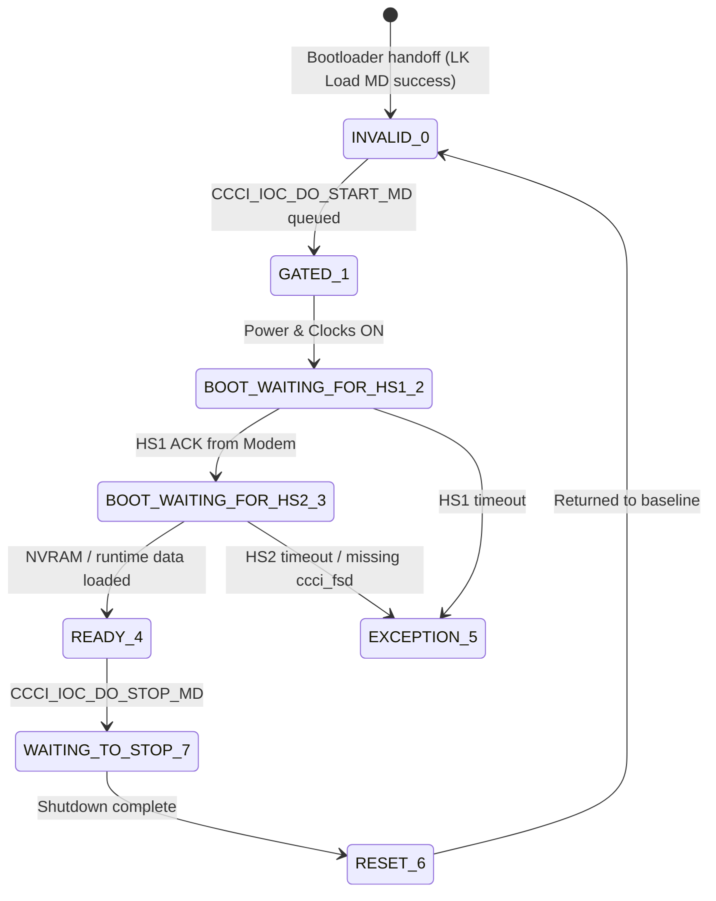

# Lynx No-SIM Modem Startup and Stop Plan (2026-11-21)

## Executive Summary

This plan provides an offline, evidence-based architecture and execution strategy for investigating the cellular modem subsystem (MD1) on the OnePlus Nord 3 5G (Lynx, CPH2493, MediaTek MT6983 / Dimensity 9000) running native Alpine Linux on boot `0fe847d2-44d6-4ac1-9000-2c99df1a51d8`.

Following Noob and Aria's explicit guidelines:
- **SIM card remains physically REMOVED.** No SIM is installed in either slot.
- **RF activation is strictly PROHIBITED.** No cellular radio transmission or network registration may occur.
- **Preflight is strictly READ-ONLY.** No CCCI character devices are opened, no sysfs attributes are written, and no services are installed during preflight.
- **Persistent phone state is UNTOUCHED.** All live probe tools must execute strictly from volatile RAM (`/run/`) with bounded execution windows, timed reboot watchdogs, and explicit rollback gates.
- **Aria reviews this plan before any live modem trial.**

---

## 1. Hardware, Bootloader, and Kernel Baseline

### 1.1 Firmware & Partition Map
- **Modem Partition (`md1img`):**
  - Partition size: 80,928,768 bytes (77.18 MiB)
  - SHA-256: `7cf648e726d4ef57e9e82eb918c113156c73f0f4118f1011973c022af10c2fa7` (verified from stock CPH2493 August EU OTA).
  - Contains MT6983 baseband DSP code, modem firmware, and protocol stack.
- **Bootloader (LK) Handshake:**
  - LK metadata captured in sysfs on V53: `LK Load MD:[Enabled]`, `LK load MD success!`, `md_en=E-D-D-D-D (1->5)`.
  - Confirms the bootloader mapped and loaded modem images into reserved modem DRAM partitions before jumping to the Linux kernel.

### 1.2 Kernel Subsystem & CCCI Nodes
- **Kernel Version:** `5.10.149-android12-9-o-g311738fbb5a8` (aarch64).
- **Loaded Modules:** `ccci_md_all`, `ccci_auxadc`, `ccci_util_lib`, `mddp`.
- **Character Nodes (`/dev/ccci*`):** 53 character devices are present:
  - Control & FSM: `/dev/ccci_ioctl0` through `/dev/ccci_ioctl4` (major 504, minors 12–16).
  - Status: `/dev/ccci_md1_sta` (major 508, minor 1), `/dev/ccci_mdx_sta` (minor 0), `/dev/ccci_pin_sta`.
  - File System & RPC: `/dev/ccci_fs` (minor 4), `/dev/ccci_rpc` (minor 20).
  - Communication Channels: `/dev/ttyC0` (AT commands), `/dev/ttyC1` (modem logger), `/dev/ttyC2` (IPC UART).
- **Current Live State:**
  - `/sys/kernel/ccci/boot` reads: `md1:0 | md2:n/a | md3:n/a | md4:n/a | md5:n/a`.
  - Live kernel messages show `mddp_rx` reporting: `port ccci_0_200 read data fail when md_state = 0` (~1/sec).
  - SIM hot-plug nodes: `MD1_SIM1_HOT_PLUG_EINT`, `MD1_SIM2_HOT_PLUG_EINT`, and `odm:oplus_sim_detect` are present in `/sys/devices/platform/` with no bound drivers.

---

## 2. Kernel CCCI FSM & Startup Mechanism

### 2.1 The Sysfs `/sys/kernel/ccci/boot` Trap
In stock source `drivers/misc/mediatek/ccci_util/ccci_util_lib_sys.c`:
```c
static ssize_t boot_status_store(const char *buf, size_t count)
{
    unsigned int md_id = buf[0] - '0';
    if (md_id < MAX_MD_NUM) {
        if (trigger_md_boot(md_id) != 0)
            CCCI_UTIL_INF_MSG("md%d n/a\n", md_id + 1);
    }
    return count; /* ALWAYS returns count! */
}
```
The underlying callback in `drivers/misc/mediatek/eccci/ccci_modem.c`:
```c
int boot_md_store(int md_id)
{
    return -EACCES; /* Unconditionally forbidden */
}
```
> [!WARNING]
> Writing to `/sys/kernel/ccci/boot` returns success (`count`) in user space but immediately fails with `-EACCES` inside the kernel. **It does not boot the modem.** Do not use sysfs writes as a probe or startup trigger.

### 2.2 The Real Startup Path: CCCI IOCTLs
The actual modem lifecycle is controlled via ioctl calls on `/dev/ccci_ioctl0`, routed to `ccci_fsm_ioctl()` in `drivers/misc/mediatek/eccci/fsm/ccci_fsm_ioctl.c`:

1. **Start Request (`CCCI_IOC_SEND_START_MD_REQUEST`):**
   - Defined as `_IO(CCCI_IOC_MAGIC, 11)`.
   - Sends `CCCI_MD_MSG_FORCE_START_REQUEST` to the FSM monitor thread.
2. **Execute Start (`CCCI_IOC_DO_START_MD`):**
   - Defined as `_IO(CCCI_IOC_MAGIC, 13)`.
   - Kernel performs a caller validation check:
     ```c
     char *VALID_USER = "ccci_mdinit";
     if (strncmp(current->comm, VALID_USER, strlen(VALID_USER)) == 0) {
         ret = fsm_append_command(ctl, CCCI_COMMAND_START, 0);
     } else {
         CCCI_ERROR_LOG(md_id, FSM, "drop invalid user:%s call MD start ioctl\n", current->comm);
     }
     ```
   - **Critical Constraint:** The calling process MUST have its process name (`comm`) set to `"ccci_mdinit"`. On Linux, this is set via `prctl(PR_SET_NAME, "ccci_mdinit")` or by naming the executable.
   - If verified, the kernel queues `CCCI_COMMAND_START` into the CCCI finite state machine, which releases the hardware reset line and powers on the baseband processor.

---

## 3. Stock Userspace (`ccci_mdinit`) Dependencies & Gaps

The stock startup daemon is `/vendor/bin/ccci_mdinit` (SHA-256 `a288eb339fbc13c7a1c135855dbd2de94b01fadc93059ec4e9f5075528582849`).

### 3.1 Binary Constraints
- **ELF Type:** 64-bit LSB pie executable, ARM aarch64.
- **Dynamic Linker:** `/system/bin/linker64` (Android Bionic).
- **Required Libraries:**
  - `libsysenv.so`
  - `liblog.so`
  - `libnvram.so` (NVRAM / calibration access)
  - `libcutils.so` (Android properties: `property_get()`)
  - `libstorage_otp.so`
  - `libhardware_legacy.so`
  - `libccci_util.so`
  - `libc++.so`, `libc.so` (Bionic C library)

### 3.2 Property & Filesystem Dependencies
Before calling `CCCI_IOC_DO_START_MD`, `ccci_mdinit`:
1. Waits for Android property `vendor.service.nvram_init == "Ready"`.
2. Accesses NVRAM calibration structures (`/mnt/vendor/nvdata/md`, `/mnt/vendor/protect_f`, `/mnt/vendor/protect_s`).
3. Reads boot configuration from `/proc/device-tree/chosen/atag,boot` and `/sys/kernel/ccci/kcfg_setting`.
4. Spawns upper-layer daemons (`ccci_fsd`, `vendor.muxreport-daemon`).

### 3.3 Alpine Strategy
Because Lynx runs native Alpine Linux (musl libc, no Android init or properties), stock `ccci_mdinit` cannot run natively.
Instead, two paths exist:
1. **Targeted Native Micro-Caller (Recommended for First Probe):** A tiny standalone C utility compiled with musl (`zig cc` or `gcc`), which:
   - Sets its comm name to `ccci_mdinit` via `prctl(PR_SET_NAME, "ccci_mdinit")`.
   - Opens `/dev/ccci_ioctl0`.
   - Issues `CCCI_IOC_GET_MD_STATE` to confirm baseline.
   - Issues `CCCI_IOC_SEND_START_MD_REQUEST` followed by `CCCI_IOC_DO_START_MD`.
   - Polls `/dev/ccci_md1_sta` or `/sys/kernel/ccci/boot` to observe state transition.
   - Immediately issues `CCCI_IOC_DO_STOP_MD` to bring MD1 back down safely.
2. **Containerized Bionic Shim:** Required only if the baseband coprocessor demands live NVRAM runtime data exchange (`ccci_fsd`) to pass Handshake 2.

---

## 4. Observable MD1 State Transitions

In MediaTek `mtk_ccci_common.h`:
```c
enum MD_STATE {
    INVALID = 0,             /* Baseline: no traffic, modem off */
    GATED = 1,               /* Power applied, waiting for clocks/gates */
    BOOT_WAITING_FOR_HS1 = 2,/* Handshake 1: boot handshake with AP */
    BOOT_WAITING_FOR_HS2 = 3,/* Handshake 2: NVRAM / runtime data exchange */
    READY = 4,               /* Full functional state (AP <-> MD link ready) */
    EXCEPTION = 5,           /* Modem assertion or crash */
    RESET = 6,               /* Reset in progress */
    WAITING_TO_STOP = 7,     /* Controlled shutdown sequence */
};
```

### Transition Sequence:


- **Target Observation for First Trial:** Reaching `BOOT_WAITING_FOR_HS1 (2)` or `BOOT_WAITING_FOR_HS2 (3)`. This proves the kernel FSM accepted the start command and the MD1 coprocessor powered on, without requiring full cellular radio services.

---

## 5. Bounded Live Trial Architecture (For Aria Review)

When Aria executes the live attended trial, the following constraints and steps must be enforced:

### 5.1 Safety Gates & Watchdogs
1. **Battery Gate:** Voltage $\ge 8400\text{ mV}$, capacity $\ge 50\%$.
2. **Thermal Gate:** SoC temperature $< 40^\circ\text{C}$.
3. **SIM Isolation:** Assert SIM hot-plug nodes unbound and tray physically empty.
4. **Volatile Staging:** The trial binary and runtime receipt must live in `/run/lynx-modem-probe-<timestamp>/` (tmpfs).
5. **Reboot Watchdog:** Arm a 120-second hardware watchdog (`/dev/watchdog`) before issuing any ioctl. If the modem causes an AP lockup, the device automatically resets to the known-good V53 state.

### 5.2 Controlled Shutdown & Rollback
- To stop the modem:
  1. Call `CCCI_IOC_DO_STOP_MD` with argument `1` (`MD_FLIGHT_MODE_ENTER`).
  2. If the modem does not transition to `WAITING_TO_STOP (7)` within 5 seconds, call `CCCI_IOC_MD_RESET`.
  3. Verify `/sys/kernel/ccci/boot` reports `md1:0` or `md1:6`.
  4. Cancel the watchdog and remove the `/run` directory.

---

## 6. Failure Recovery Matrix

| Failure Mode | Symptom | Immediate Action | Recovery / Rollback |
| :--- | :--- | :--- | :--- |
| **Invalid Caller Rejection** | Kernel log: `drop invalid user:...` | Check `prctl(PR_SET_NAME)` in probe tool. | Exit 0 with explanation; no hardware change occurred. |
| **Modem Handshake 1 Hang** | State stuck in `BOOT_WAITING_FOR_HS1 (2)` | Wait max 10s. Issue `CCCI_IOC_DO_STOP_MD`. | Force reset with `CCCI_IOC_MD_RESET`. |
| **Modem Assertion / Crash** | State transitions to `EXCEPTION (5)`, kmsg dump | Collect error code via `CCCI_IOC_GET_MD_EX_TYPE`. | Issue `CCCI_IOC_MD_RESET`, cancel watchdog. |
| **AP Kernel Lockup / Panic** | SSH disconnects, no heartbeat | Do NOT write to storage. | 120s reboot watchdog reboots device into clean V53 rootfs. |
| **Persistent Mod State** | `/sys/kernel/ccci/boot` remains non-zero | Reboot via `reboot` command. | Re-check `lynx-status --assert-ready` after reboot. |

---

## 7. Deliverable Artifacts

1. **Document:** `/noobia/lynx/linux-port/docs/LYNX-MODEM-START-PLAN-20261121.md` (this file).
2. **Preflight Tool:** `/noobia/lynx/tools/lynx_modem_preflight.py` (strict read-only preflight gate).
3. **Unit Tests:** `/noobia/lynx/tools/test_lynx_modem_preflight.py` (offline verification suite).
