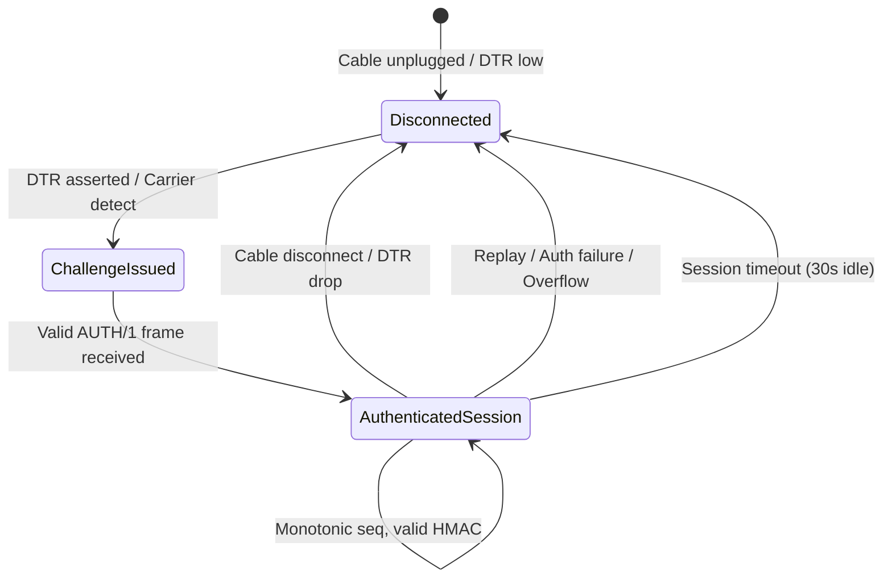

# Lynx USB ACM Agent Transport Protocol and Trust Boundary (2026-11-21)

## Executive Summary

This document presents the protocol architecture, security trust boundary, and failure mechanics for operating Noob Runtime Protocol (NRP/1) agent communications over the USB CDC ACM serial link (`/dev/ttyACM0` on Nexus host $\leftrightarrow$ `/dev/ttyGS0` on Lynx Alpine Linux).

It accompanies the offline parser and transport prototype in [`lynx/tools/usb/lynx_usb_nrp_transport.py`](file:///noobia/lynx/tools/usb/lynx_usb_nrp_transport.py) and unit tests in [`lynx/tools/usb/test_lynx_usb_nrp_transport.py`](file:///noobia/lynx/tools/usb/test_lynx_usb_nrp_transport.py).

**Feasibility Verdict:** **FEASIBLE with Strict Boundaries.**
The USB ACM link can safely carry authenticated, framed NRP/1 messages and bounded diagnostic pings. However, it must **never** be bridged directly to an unauthenticated root shell, raw PTY, or arbitrary system sockets. The existing pinned Wi-Fi SSH route remains the primary management and recovery lifeline.

---

## 1. Framing and Protocol Specification

### 1.1 The Serial Stream Challenge
Unlike datagram-oriented network transports (UDP, Bluetooth LE ATT), a raw serial stream (`cdc_acm`) does not guarantee packet atomicity. Bytes written by the host may arrive in fragmented chunks or coalesce across buffer boundaries.

To establish reliable, deterministic message exchange, the transport utilizes newline-delimited framing matching native NRP/1:
*   **Delimiter:** Single ASCII newline (`\n`, `0x0A`).
*   **Maximum Frame Size (`MAX_FRAME`):** 512 bytes (including newline). Any frame exceeding 512 bytes without a delimiter is immediately rejected.
*   **Stream Buffer Cap (`MAX_BUFFER`):** 2048 bytes. If buffered incoming bytes exceed 2048 bytes without encountering a valid delimiter, the buffer is dropped to prevent memory exhaustion from noise or misconfigured baud rates.

### 1.2 Authenticated Envelope Grammar
All agent-level commands (e.g. `STATUS`, `INFO`, `CALL <tool>`, `CAPS`, `VM_LOAD`) must be encapsulated within an `AUTH/1` envelope:

$$\texttt{AUTH/1 } \langle\text{sequence}\rangle \texttt{ } \langle\text{hmac-sha256-hex}\rangle \texttt{ } \langle\text{NRP/1 command}\rangle\texttt{\textbackslash n}$$

*   **Sequence:** A positive, strictly monotonically increasing integer ($1 \le \text{seq} < 2^{32}$).
*   **HMAC-SHA256:** A 64-character lowercase hexadecimal MAC computed over:
    $$\text{HMAC}(\text{key}, \texttt{"LYNX-USB-NRP/1\textbackslash0"} \,||\, \text{challenge} \,||\, \text{uint32\_be}(\text{sequence}) \,||\, \text{payload})$$
    *   `key`: 32-byte shared symmetric secret (e.g. `/etc/lynx/nrp-nexus.key`).
    *   `challenge`: 32-byte random session challenge issued by Lynx upon connection establishment.
    *   `payload`: Complete ASCII NRP/1 command ending with `\n`.

### 1.3 Unauthenticated Diagnostic Subset (`DIAG/1`)
For bounded hardware readiness probes prior to cryptographic key negotiation:
*   $\texttt{DIAG/1 } \langle\text{seq}\rangle \texttt{ PING\textbackslash n} \longrightarrow \texttt{DIAG/1 } \langle\text{seq}\rangle \texttt{ PONG\textbackslash n}$
*   $\texttt{DIAG/1 } \langle\text{seq}\rangle \texttt{ STATUS\textbackslash n} \longrightarrow \texttt{DIAG/1 } \langle\text{seq}\rangle \texttt{ OK link=acm mode=3\textbackslash n}$
*   This subset permits zero system state changes, does not execute shell scripts, and does not return confidential system facts.

---

## 2. Trust Boundaries and Privilege Separation

### 2.1 Why Raw Shell Bridging Is Prohibited
In typical embedded development, serial gadgets are often attached to `getty` or a root shell. In the Noobia architecture, bridging `/dev/ttyGS0` to a root shell or unauthenticated root PTY introduces a critical security vulnerability:
*   Anyone with physical USB access to Lynx could issue unrestricted root commands.
*   Electrical glitches on the physical D+/D- lines can inject spurious carriage returns or escape characters, corrupting shell sessions.
*   An unauthenticated root bridge bypasses all agent auditing, Council consensus, and forge-db receipts.

### 2.2 Privilege Isolation Model
1. **Unprivileged Listener:** When deployed in a future milestone, the phone-side serial listener must run under an unprivileged agent daemon (`lynx-noobd` or dedicated `lynx-usb-agent`), never as root.
2. **Grammar Enforcement:** The parser rejects any byte sequence that does not match `AUTH/1` or `DIAG/1` regular expressions prior to dispatching to function handlers.
3. **Replay Rejection:** If `sequence <= highest_sequence_seen`, the frame is rejected with an explicit `AuthenticationError`, defeating replay attacks from reconnected USB cables or sniffing.
4. **Session Challenge Expiry:** The 32-byte challenge is regenerated whenever the USB link drops DTR (Data Terminal Ready) or experiences a timeout exceeding 30 seconds.

---

## 3. Disconnect Teardown and Failure Recovery

### 3.1 Failure Teardown Rules:
1. **Physical Cable Disconnect:** Detected via DTR drop on `/dev/ttyGS0` or `ioctl(TIOCMGET)`. The parser immediately calls `reset()`, wiping partial buffers and resetting the monotonic sequence counter.
2. **Buffer Overflow:** If unparsed bytes exceed `MAX_BUFFER` (2048 bytes), the buffer is purged and a transport error is logged.
3. **Primary Recovery Route:** The USB ACM transport is strictly an auxiliary communication channel. If the USB channel wedges, errors out, or fails to authenticate, it must **never** attempt to restart Wi-Fi or alter system network routes. Wi-Fi SSH (`192.168.100.107:2222`) remains the authoritative recovery route.

---

## 4. Prototype Verification Summary

The offline prototype implementation ([`lynx_usb_nrp_transport.py`](file:///noobia/lynx/tools/usb/lynx_usb_nrp_transport.py)) was verified via [`test_lynx_usb_nrp_transport.py`](file:///noobia/lynx/tools/usb/test_lynx_usb_nrp_transport.py) across 9 test cases:
*   `test_valid_frame_roundtrip`: Successful signing, framing, and verification of `NRP/1 1 STATUS`.
*   `test_sequence_monotonicity_and_replay_rejection`: Immediate rejection of replayed and decrementing sequence numbers.
*   `test_malformed_frames_rejected`: Rejection of corrupted syntax, missing newlines, and invalid headers.
*   `test_corrupted_signature_rejected`: Deterministic failure on single-bit HMAC corruption.
*   `test_length_limits`: Enforcement of `MAX_FRAME` (512 bytes) on oversized payloads.
*   `test_streaming_fragmentation_and_assembly`: Seamless reassembly of frames fed in arbitrary 7-byte chunks across serial buffer boundaries.
*   `test_streaming_buffer_overflow_protection`: Immediate memory purge when buffer exceeds `MAX_BUFFER` without newline.
*   `test_unauthenticated_diagnostic_ping`: Bounded verification of `DIAG/1 42 PING`.
*   `test_simulated_channel_disconnect`: Immediate `DisconnectError` propagation upon link termination.

---

## 5. Next Steps for Hardware Deployment (Future Work)

Per backlog constraints, this prototype is **strictly offline** and has not been deployed to the live Lynx rootfs. Before any live deployment to Lynx:
1. An unprivileged Unix user/group must be established on Lynx for USB agent execution.
2. An OpenRC service definition (`lynx-usb-noobd`) must be drafted with strict non-root limits and systemd/OpenRC sandboxing.
3. Live trials will require Aria's explicit review and attendance.
