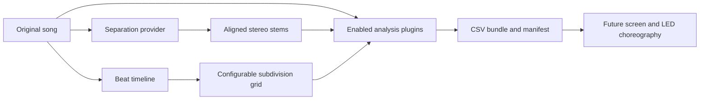

# Rose's party creator: analysis foundation

Turn a song and its separated stems into reusable measurements for Noobians'
screens, LEDs, and instruments. Research checked on 2026-10-05; the first actual
song has not yet been supplied. Device choreography is a later stage.

## Service recommendation

**Start with one external provider: LALAL.AI, using the credits already owned.**
The other stages have local implementations available. A fully local pipeline
needs **zero external processing services** after downloading libraries and
models. Installation, hardware suitability, and accuracy still need verification
on Nexus and the chosen song.

| Stage | Local candidate | Optional cloud provider | Decision |
|---|---|---|---|
| Separation | audio-separator with Demucs / RoFormer models | LALAL.AI or Music.ai | Start with existing LALAL credits; compare local output |
| Beats / BPM | Beat This! | Music.ai | Prefer local; allow manual corrections |
| Level / stereo balance | PCM measurements in this runner | None needed | Local |
| Timed lyrics | WhisperX, optionally align corrected lyrics | Music.ai Lyrics | Try local on isolated lead vocals; inspect singing errors |
| Pitched notes / MIDI | Spotify Basic Pitch | Klangio | Start local on individual pitched stems |
| Drum events | Omnizart candidate, dedicated onset analysis | Evaluate specialist support separately | Separate plugin; no pretending drum hits are pitched tones |
| CSV and choreography | Our pipeline | None needed | Local |

Music.ai is my preferred **cloud alternative to evaluate**, because its platform
has separation, beat maps, and lyrics transcription/alignment. Its Lyrics module
is specifically optimized for singing. That is a fit recommendation, not a
measured quality win on our song. [Modules and workflows](https://music.ai/workflows/),
[Lyrics documentation](https://music.ai/modules/transcription/lyrics/),
[Beats documentation](https://music.ai/modules/transcription/beats/).

The initial hybrid uses **one** provider. Adding Music.ai for difficult lyrics
while keeping LALAL makes **two**. Replacing LALAL with Music.ai keeps the count
at **one**. Adding Klangio for difficult note transcription would add one more;
it is optional, not a dependency. Its API documents MIDI export, source
separation, and beat tracking. Verify the needed instrument models and timing
behavior before integrating. [Klangio API](https://api-docs.klang.io/).

### LALAL.AI: verified input and output

The website accepts common audio and video formats; prefer WAV or FLAC for our
experiments. Its advertised stem choices include vocals, drums, bass, guitars,
piano, synths, strings, and winds. [Stem Splitter](https://www.lalal.ai/stem-splitter/).

The current **v1 API** uses `X-License-Key`. Upload raw file bytes with a
`Content-Disposition` filename; receive an ID, name, byte size, duration, and
expiry. Submit that source ID and presets; receive a task ID. Poll using task
IDs. Successful results contain duration and tracks with type, label, and URL.

Single-stem extraction returns the target plus its complement. Multistem accepts
up to six choices: vocals, drum, piano, bass, electric guitar, acoustic guitar;
returns those plus `no_multistem`. Extraction is internally sequential.
Synth/strings/winds require single-stem requests. Lead/back vocal mode provides
additional vocal outputs. Request WAV explicitly; v1 output choices are MP3,
WAV, FLAC, AAC, OGG. v0 documentation is deprecated. Download results promptly:
task checking is available for 24 hours. These are audio files, not beat, lyric,
or MIDI analyses. [Current API specification](https://www.lalal.ai/api/v1/openapi.json).

The FAQ confirms paid activation keys provide API access. Billing is duration
times separation count: a five-minute song with vocals, drums, and bass costs
15 processing minutes. We have not inspected your account or spent any credits.
[Activation keys and billing](https://www.lalal.ai/guides/faq/).

### Local separation alternatives

`audio-separator` provides a programmable wrapper around multiple model
families, including Demucs and RoFormer. Compare a vocal-focused RoFormer with
LALAL for lyric clarity, and Demucs for simultaneous instrument groups. Record
the model and gain settings; wrappers may normalize outputs.
[audio-separator](https://github.com/nomadkaraoke/python-audio-separator).

Demucs offers four stereo stems (vocals, drums, bass, other) and an experimental
six-stem model adding guitar/piano. Its authors flag weaker piano results and
warn automatic rescaling can alter relative stem levels. The original Meta
repository is archived, so evaluate maintained wrappers rather than depending
on it as an actively maintained application.
[Demucs documentation](https://github.com/facebookresearch/demucs).

No separator reconstructs the original studio sessions exactly. Benchmark on
the same recording: bleed, missing notes, stereo preservation, timing offsets,
gain changes, transcription quality, processing time, and credit cost. Whole
song measurements always come from the original mix, not a sum of overlapping
separation outputs.

### Lyrics and note transcription

WhisperX supplies local transcription followed by word alignment. Some words
cannot be aligned; overlapping voices and language-specific alignment models
need attention. Treat singing performance as an experiment and retain missing
timings rather than inventing them. Correct lyrics first when recognition is
poor, then align against the isolated vocal track.
[WhisperX](https://github.com/m-bain/whisperX).

Basic Pitch produces polyphonic MIDI with pitch bends and works best on a single
instrument at a time. Start with bass, voice, piano, and clean guitar stems;
do not promise faithful transcription of every distorted, layered, or noisy
instrument. Keep the original event times and model outputs.
[Basic Pitch](https://github.com/spotify/basic-pitch).

Drums need hit times and instrument classes, not a frequency inferred from a
General MIDI drum number. Omnizart is a local candidate with pretrained drum
transcription; its documentation also flags limitations. Test in a separate
environment before adopting it.
[Omnizart](https://github.com/Music-and-Culture-Technology-Lab/omnizart).

## Pipeline and time contracts



- One absolute clock: seconds from the start of the original recording.
- `subdivisions_per_beat: 4` means four markers per detected beat: 125 ms at
  120 BPM. Set it to `1` for one marker per beat/quarter note: 500 ms at 120 BPM
  when the beat unit is a quarter note. BPM alone does not establish meter.
- Use actual beat positions for changing tempo. Subdivide each beat interval;
  do not force the whole song onto a constant-BPM grid. Straight subdivisions
  are a reference grid; swing and performed note timings remain separate.
- The intro and tail get extrapolated coverage, explicitly marked. Manual BPM
  grids are labeled manual, never called detected. Detected downbeats/meter are
  future metadata; the current runner does not invent bar numbers.
- Require aligned, equal-duration stems. The runner checks length, but does not
  detect same-length latency shifts. Verify offsets before importing. Preserve
  stereo and relative gain; do not trim silence or independently normalize.
- Store native note/word timing separately from grid measurements. Fast drum
  hits or several words can occupy one grid interval. Future envelope plugins
  can add fixed 10–20 ms frames and onset peaks without changing this grid.

## Working first version

`party.py` runs without third-party dependencies for PCM WAV input, manual or
imported beats, level/balance analysis, and imported WhisperX word JSON.

Implemented:

- Enabled/disabled analysis plugins; external `module:function` plugins.
- Streaming 8/16/24/32-bit integer PCM WAV measurements, mono or stereo.
- Manual BPM and offset, imported beat times, optional Beat This! adapter.
- Per-track and original-mix RMS/peak and left/right energy balance per grid
  interval; source hashes and configuration in a run manifest.
- Imported word timings and optional MIDI-to-note CSV via `mido`.
- New output directories only; failures are marked in the manifest.

**Not yet implemented or exercised:** automatic separation, automatic lyric
recognition, audio-to-MIDI generation, drum classification, or device playback.
Beat This! and `mido` adapters require dependencies and have not been run here.
The Nexus default Python currently has none of the researched audio libraries
installed. The base runner is deliberately usable before those installations.

Copy `example.json`, place the song and downloaded stems in `media/` and adjust
the track paths. Paths are relative to the configuration file. Start with
just `mix` if the stems are not ready. Convert compressed or floating-point
audio to integer PCM WAV using a decoder such as FFmpeg; keep stereo and do not
add loudness normalization. The song choice and file are still needed.

```bash
cd /noobia/rose_tools/rose_composer
python3 party.py example.json --out runs/first-experiment-001
python3 -m unittest -v test_party.py
```

For externally detected or corrected beats:

```json
{"mode": "json", "path": "media/beats.json", "subdivisions_per_beat": 4}
```

with input `{"beat_times_s": [0.23, 0.73, 1.24, 1.76]}`. For optional local
detection set `"mode": "beat_this"`, `"device": "cpu"` (or a verified GPU
device), and install Beat This! into an isolated environment first. Its inference
can download model weights. [Beat This!](https://github.com/CPJKU/beat_this).

### CSV contracts, schema version 1

| File | Meaning |
|---|---|
| `beats.csv` | Beat index, absolute time, detector/manual source |
| `grid.csv` | Tick, beat index, subdivision, start/end seconds, timing source |
| `levels.csv` | Track, tick, start/end, RMS linear/dBFS, sample peak linear/dBFS |
| `panning.csv` | Track, tick, start/end, pan, left/right percentages, validity, channels |
| `words.csv` | Track, exact word start/end, text, alignment score, status |
| `notes.csv` | Track, exact note start/end, MIDI pitch, Hz, velocity, channel, event type |
| `manifest.json` | Schema version, source hashes, configuration, analysis status |

`rms_dbfs` measures digital signal level, not room SPL or perceptual LUFS.
Silence is floored at −120 dBFS. Stereo RMS averages channel energy, avoiding
phase cancellation from a mono downmix. Stem levels describe the separator's
output; changed provider gain makes comparisons to original instrument levels
unreliable. Future LUFS should be a separate enabled plugin.

Pan convention: 0 = all left, 50 = equal left/right, 100 = all right.
`right_pct = 100 * sum(R²) / (sum(L²) + sum(R²))`; `left_pct = 100-right_pct`.
This is measured energy balance, not the original mixer's pan knob or a complete
spatial localization estimate. Silent windows have blank percentages and
`pan_valid=0`. Mono material is centered and identified by `channels=1`.

MIDI pitch maps to `frequency_hz = 440 * 2**((midi_note-69)/12)` using A4=440 Hz.
This is the nominal equal-tempered tone; pitch bends need their own future curve
CSV. MIDI velocity is not measured acoustic volume. Channel 10 percussion
(zero-based channel 9) keeps its drum note number and has no tonal frequency.
The MIDI importer respects tempo changes, and refuses unfinished notes and
asynchronous type-2 files. Use transcription exports aligned to song time,
without score-oriented quantization or trimmed lead-in.

### Adding analysis plugins

Add an installed/local module with a function `analyze(context, options)`.
It receives paths, the shared grid, track statistics (when levels/panning are
enabled), output directory, and song duration. It writes its own CSV and returns
a list of output filenames. The runner never imports disabled plugins.

```json
"spectral_brightness": {
  "enabled": true,
  "callable": "my_analysis:analyze",
  "frame_ms": 20
}
```

Plugins are trusted local Python code. Keep heavy model environments separate
as needed and bridge them with files; preserve provider/model versions,
parameters, gain/offset transforms, and original JSON/MIDI beside the CSV exports
when those provider integrations are added. Each provider should ultimately
offer the same stage contract, so swapping separation or lyrics engines does
not affect device choreography.

## First experiment

1. Pick the exact recording and obtain a local file; preserve its hash.
2. Use existing LALAL credits for vocals, drums, and bass, exporting WAV.
3. Verify alignment and gain, correct the beat grid by listening, produce local
   level and panning CSVs.
4. Run local timed lyrics and pitched-note models in isolated environments;
   import outputs, checking representative sections by ear.
5. Compare local separation on the same recording. Add Music.ai/Klangio only
   where the tested output improves enough to justify another provider.
6. Choose screen/LED mappings using the verified CSVs and a shared playback
   clock; keep hardware overrides and stop controls available.
